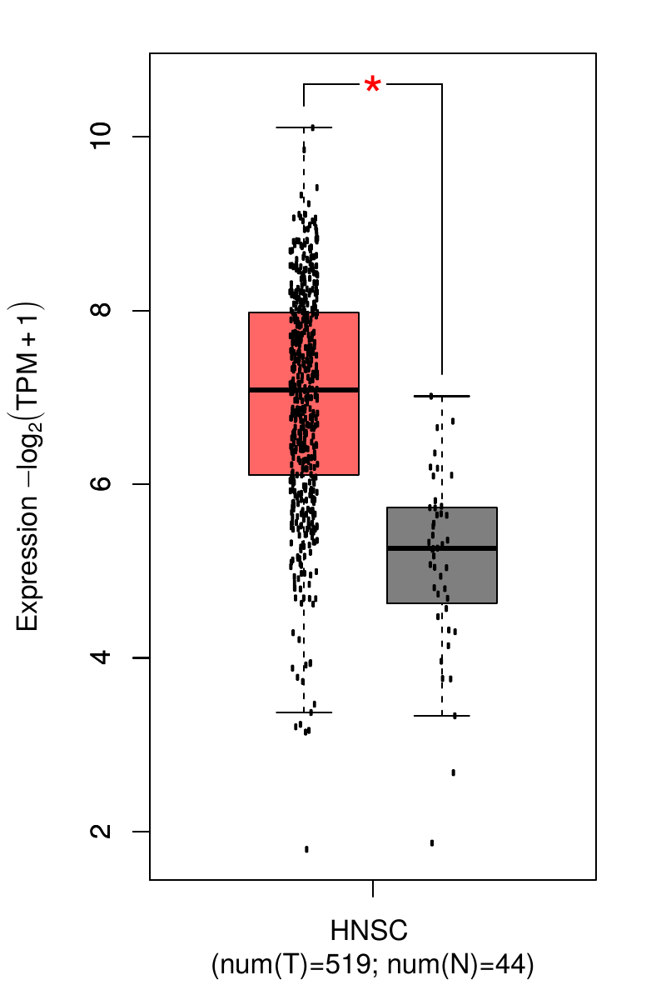
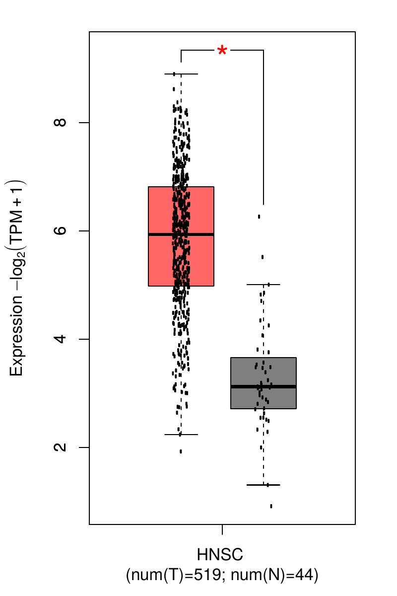
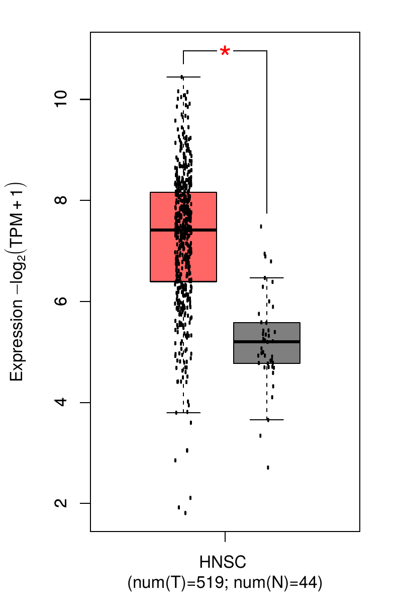
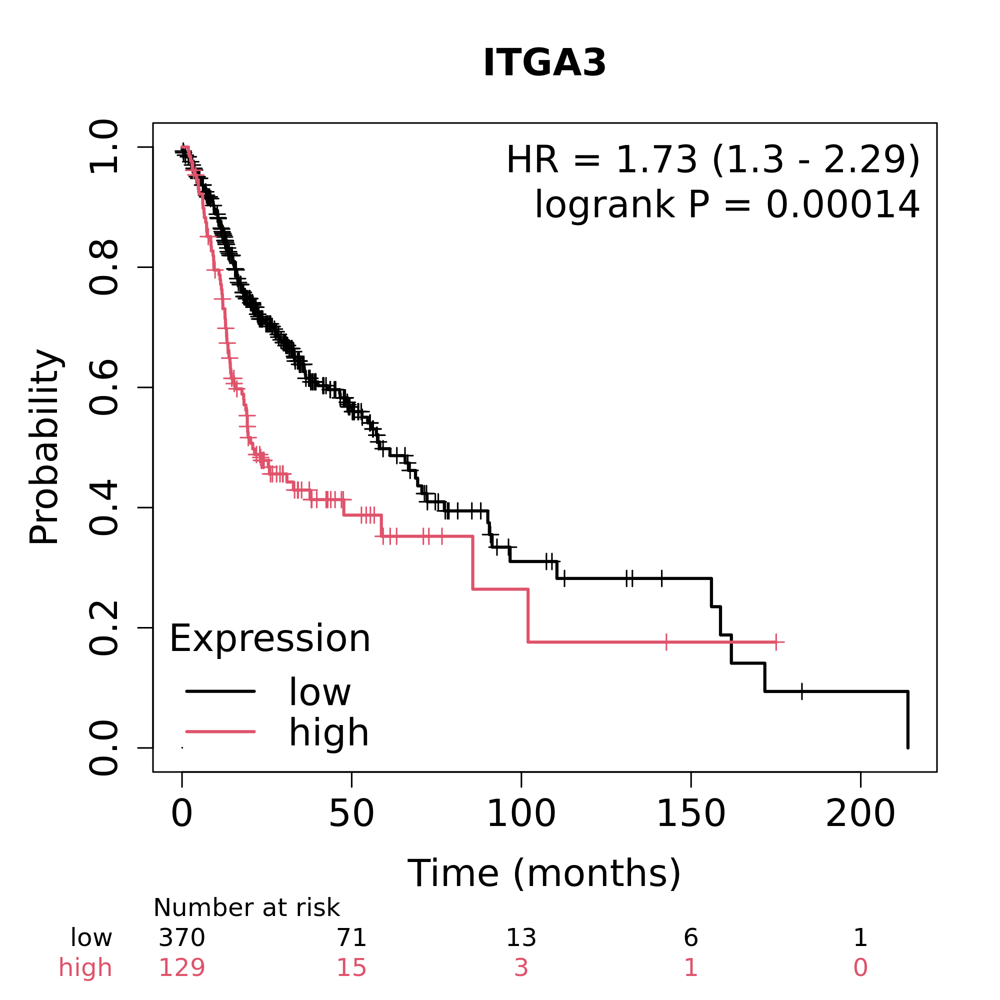
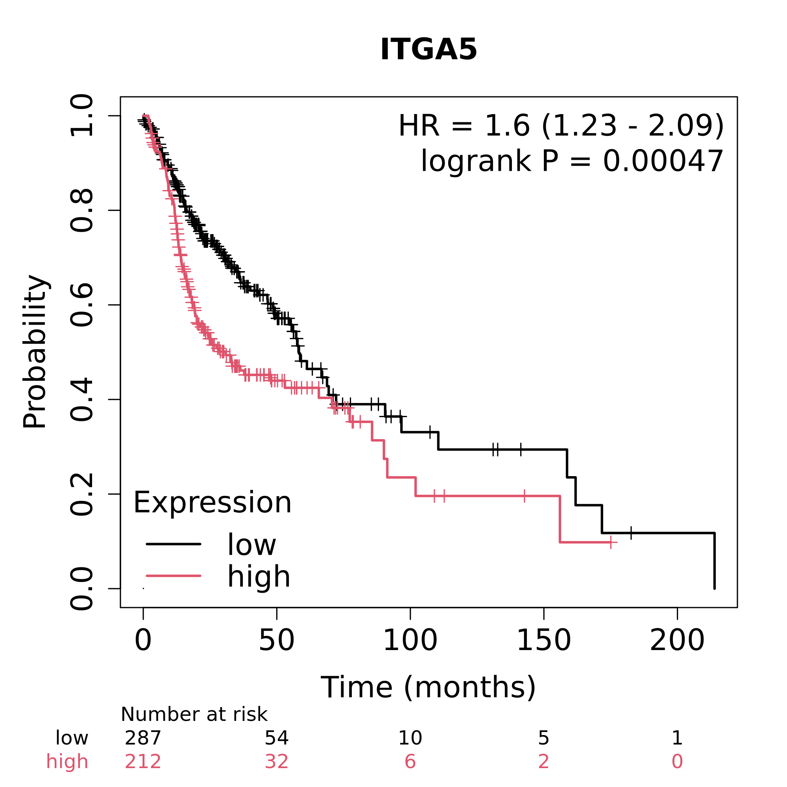
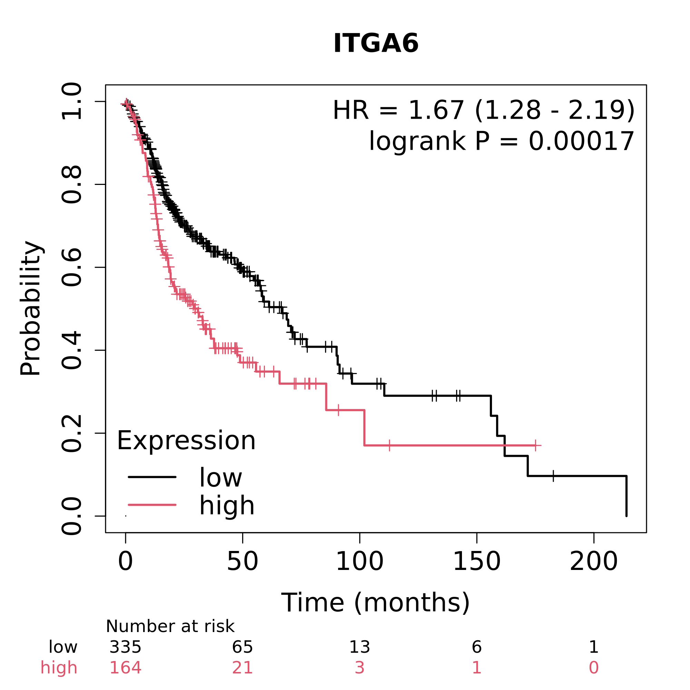

# ITGA3 · ITGA5 · ITGA6 HNSCC 논문 재현 (웹 도구)

두경부 편평세포암(HNSCC)에서 ITGA3, ITGA5, ITGA6의 발현과 전체 생존을 분석한 논문을, 코드 없이 공개 웹 도구(GEPIA2, Kaplan-Meier Plotter)만으로 재현한 기록입니다.

## 한눈에 보기

- **발현 비교**: 세 유전자 모두 종양에서 정상보다 높게 발현되어 논문과 같은 결과가 나왔습니다.
- **전체 생존**: 세 유전자 모두 발현이 높은 그룹의 생존이 나빴습니다(HR 1.60~1.73, 모두 P < 0.001). 논문과 방향이 같고, ITGA3는 수치까지 일치했습니다.
- **발견한 점**: 논문 Figure 12A(ITGA3)의 그룹 인원 표기가 내 결과와 달랐습니다. 아래 [논문과 다른 점](#논문과-다른-점)에 정리했습니다.

## 왜 이 실습을 했는가

- 의료 데이터 분석의 첫 단계로, 표 형태라 다루기 쉬운 임상 데이터와 유전자 발현 데이터부터 시작하기 위해
- 머신러닝으로 넘어가기 전에 생존분석(Kaplan–Meier 곡선, 위험비)의 기초를 익히기 위해
- 발표된 논문의 그림을 직접 다시 그려, 같은 결과가 나오는지 확인하기 위해

## 재현한 논문

Feng C, Jin X, Han Y, Guo R, Zou J, Li Y, Wang Y. **Expression and Prognostic Analyses of ITGA3, ITGA5, and ITGA6 in Head and Neck Squamous Cell Carcinoma.** *Med Sci Monit.* 2020;26:e926800.
[doi:10.12659/MSM.926800](https://doi.org/10.12659/MSM.926800) · [PMC7594586](https://www.ncbi.nlm.nih.gov/pmc/articles/PMC7594586/)

- **논문의 결론**: 세 유전자 모두 HNSC에서 발현이 증가했고, 발현이 높을수록 전체 생존이 나빴다.
- **재현 범위**: Figure 2(발현 비교)와 Figure 12 A–C(전체 생존 곡선)
- **재현하지 않은 부분**: Figure 12의 무재발 생존(RFS)과 그 밖의 분석

## 방법

### 1. 발현 비교 — [GEPIA2](http://gepia2.cancer-pku.cn)

| 항목 | 설정 |
| --- | --- |
| 메뉴 | Expression DIY › Box Plot |
| 유전자 | ITGA3, ITGA5, ITGA6 |
| 암종 | HNSC |
| \|Log2FC\| Cutoff | 1 |
| p-value Cutoff | 0.01 |
| Log Scale | Yes, log2(TPM+1) |
| 정상 데이터 | TCGA normal + GTEx |

정상 데이터를 TCGA normal만 쓰는 설정으로도 그려 보았는데, 두 경우 모두 종양 519개, 정상 44개로 샘플 수가 같았습니다.

### 2. 생존분석 — [Kaplan-Meier Plotter](https://kmplot.com)

| 항목 | 설정 |
| --- | --- |
| 데이터 | Pan-cancer RNA-seq |
| 유전자 | ITGA3, ITGA5, ITGA6 |
| Split patients by | Auto select best cutoff |
| Survival | OS (전체 생존) |
| Follow up threshold | all |
| 암종 | Head-neck squamous cell carcinoma (n=500) |
| 하위 조건 | 모두 all (제한 없음) |

## 결과

### 1. 발현 비교: 세 유전자 모두 종양에서 높다

| ITGA3 | ITGA5 | ITGA6 |
| :---: | :---: | :---: |
|  |  |  |

GEPIA2에서 직접 그린 그림입니다. 빨강은 종양(519개), 회색은 정상 조직(44개)입니다.

| 유전자 | 종양 중앙값 | 정상 중앙값 |
| --- | --- | --- |
| ITGA3 | 약 7.1 | 약 5.3 |
| ITGA5 | 약 5.9 | 약 3.1 |
| ITGA6 | 약 7.4 | 약 5.2 |

단위는 log2(TPM+1)이며, 그림에서 눈으로 읽은 대략값입니다.

**논문 Figure 2와 비교**: 샘플 수(종양 519, 정상 44)가 같고, 세 유전자 모두 방향과 유의 표시(*)가 같았습니다.

### 2. 전체 생존: 발현이 높은 그룹의 생존이 나쁘다

| ITGA3 | ITGA5 | ITGA6 |
| :---: | :---: | :---: |
|  |  |  |

Kaplan-Meier Plotter에서 직접 그린 그림입니다. 검은 선은 발현 낮음, 빨간 선은 발현 높음이고, 환자는 유전자마다 총 499명입니다.

**논문 Figure 12 A–C와 비교**

| 유전자 | 논문 HR (95% CI) | 내 HR (95% CI) | 논문 P | 내 P | 논문 낮음/높음 | 내 낮음/높음 |
| --- | --- | --- | --- | --- | --- | --- |
| ITGA3 | 1.73 (1.30–2.29) | 1.73 (1.30–2.29) | 0.00014 | 0.00014 | 286 / 213 | 370 / 129 |
| ITGA5 | 1.63 (1.25–2.13) | 1.60 (1.23–2.09) | 0.00029 | 0.00047 | 286 / 213 | 287 / 212 |
| ITGA6 | 1.70 (1.30–2.23) | 1.67 (1.28–2.19) | 0.0001 | 0.00017 | 334 / 165 | 335 / 164 |

낮음/높음은 그림 아래 Number at risk의 시작 인원이고, 논문 값은 Figure 12 A–C에서 읽었습니다.

## 논문과 다른 점

- **ITGA3의 그룹 인원**: 논문 패널 A에는 286/213으로 적혀 있는데, 이는 패널 B(ITGA5)와 같은 숫자입니다. 내 결과는 370/129인데 HR, 신뢰구간, P값은 논문과 완전히 같습니다. 인원이 다르게 적힌 이유는 확인하지 못했습니다.
- **ITGA5, ITGA6의 작은 차이**: HR 차이가 0.03이고 그룹 인원이 1명씩 다릅니다. 논문이 나온 2020년 이후 도구의 데이터가 갱신되었기 때문일 수 있습니다(추정).
- **기준값 설정**: 논문에는 환자를 나누는 기준값 설정이 적혀 있지 않습니다. 자동 최적 기준값에서 ITGA3 수치가 완전히 일치했으므로, 논문도 같은 설정을 썼을 가능성이 높다고 판단했습니다(추정).
- **도구 버전**: 논문은 GEPIA를, 나는 GEPIA2를 사용했습니다. 샘플 수는 같았습니다.

## 해석할 때 주의할 점

- 자동 최적 기준값은 두 그룹의 차이가 가장 크게 나오는 지점을 고릅니다. 그래서 HR이 크게, P값이 작게 나오기 쉽습니다.
- Kaplan-Meier Plotter의 P값은 기본 설정에서 다중 검정 보정을 하지 않습니다.
- 같은 논문의 TCGA 단변량 Cox 분석에서는 세 유전자의 HR이 1.33~1.46으로 더 작았습니다.
- 이 분석은 발현과 예후의 연관성을 보여 줄 뿐, 원인과 결과를 증명하지는 않습니다.

## 배운 것

| 용어 | 뜻 |
| --- | --- |
| 박스플롯 | 그룹별 값의 분포를 상자(중앙값과 사분위수)로 그린 그래프 |
| 전체 생존(OS) | 기준 시점부터 원인과 관계없이 사망할 때까지의 기간 |
| Kaplan–Meier 곡선 | 시간에 따른 생존 확률을 계단 모양으로 그린 그래프 |
| log-rank 검정 | 두 그룹의 생존 곡선이 서로 다른지 확인하는 검정 |
| 위험비(HR) | 두 그룹의 사망 위험의 비. 1보다 크면 위험 증가 |
| 기준값(cutoff) | 발현 높음/낮음 두 그룹을 나누는 값 |

## 다음 단계

- [ ] 기준값을 중앙값으로 바꿔 다시 그려 보고 HR이 어떻게 달라지는지 확인
- [ ] TCGA-HNSC 데이터를 직접 받아 Python(pandas, lifelines)으로 같은 곡선 그리기
- [ ] 나이, 병기를 보정하는 Cox 회귀 익히기

## 폴더 구성

```
.
├── README.md
└── figures/
    ├── gepia2_boxplot_ITGA3.png
    ├── gepia2_boxplot_ITGA5.png
    ├── gepia2_boxplot_ITGA6.png
    ├── km_os_ITGA3.png
    ├── km_os_ITGA5.png
    └── km_os_ITGA6.png
```

## 참고

- 논문의 원본 그림(Figure 2, Figure 12)은 이 저장소에 싣지 않았습니다. 위 논문 링크에서 볼 수 있습니다.
- 사용한 웹 도구: GEPIA2 (gepia2.cancer-pku.cn), Kaplan-Meier Plotter (kmplot.com)
